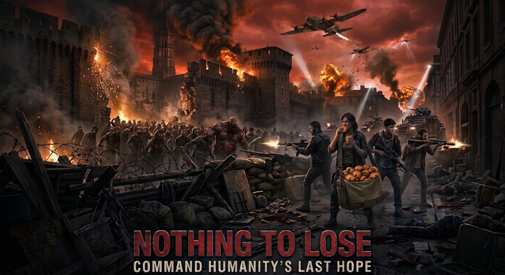

# Nothing To Lose

**Command humanity's last hope**

> « Invasion zombie mondiale, Toulouse est le dernier bastion de l'humanité. Mais une brèche durant la nuit a vu des centaines d'infectés entrer dans la ville, notre groupe de combattants est le dernier espoir de l'humanité. Ceux qui ont déjà tout perdu (familles, maisons, rêves), perdront-ils aussi leur humanité pour la préserver ? Vous seul pourrez les guider, alors commandez avec brio ! »

Démonstrateur d'IA : une invasion zombie dans le centre de Toulouse. Les zombies décident par instinct grâce à **Laya** (modèle de décision de Convai Innovations), les survivants raisonnent et se parlent par une radio qui grésille grâce à un **LLM local**. Les ordres arrivent déformés, les survivants n'obéissent pas toujours, et la ville se referme sur eux.

« Nothing To Lose » est le nom du jeu, centré sur Toulouse.

- Conception : [`docs/conception/README.md`](docs/conception/README.md)
- Jalons du prototype (phase 0) : [`docs/conception/16-jalons.md`](docs/conception/16-jalons.md)
- Instructions de travail avec Claude Code : [`CLAUDE.md`](CLAUDE.md)
- Base documentaire : [`docs/README.md`](docs/README.md)
- Prototype de rendu (à ouvrir dans un navigateur) : [`web/viewer/prototype/index.html`](web/viewer/prototype/index.html)

## Prérequis

- Rust (stable) avec la cible `wasm32-unknown-unknown`, `wasm-pack`
- Python 3.11+
- Node.js 20+
- [`just`](https://github.com/casey/just)
- Terraform ≥ 1.6 (configuration GitHub, voir [`docs/technique/ci-cd.md`](docs/technique/ci-cd.md))
- TabbyAPI (LLM local) et le paquet `laya` (à partir des jalons P3/P4)
- Claude Code à jour (les alias `opus`, `sonnet` et `haiku` des sous-agents suivent la version de Claude Code)

## Données

Carte : © OpenStreetMap contributors (ODbL) ; hauteurs de bâtiments : IGN BD TOPO (Licence Ouverte Etalab 2.0).
